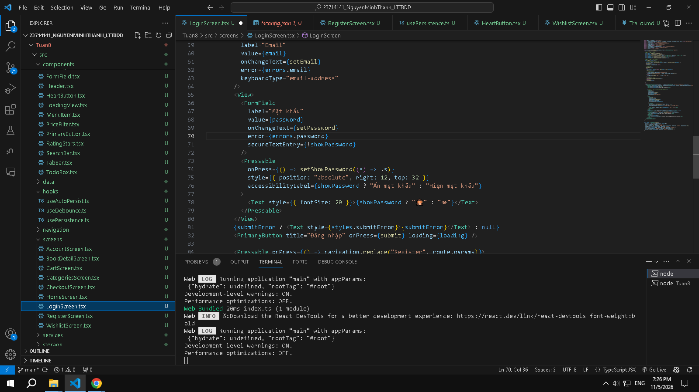
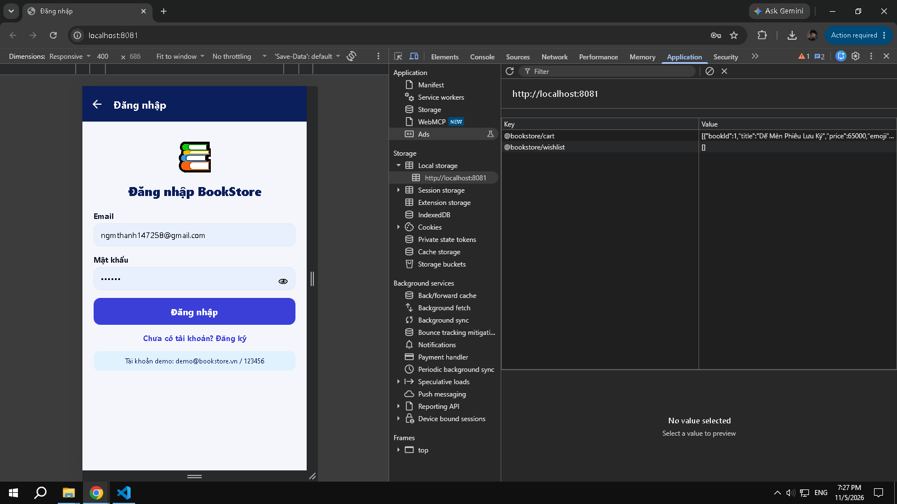
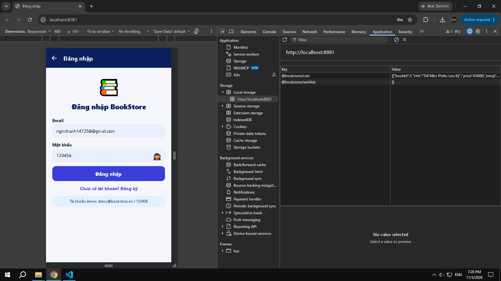

Câu 1. Cờ ready
Nếu bỏ điều kiện ready, ở lần render đầu giỏ hàng trong store còn là []. Sau lần render đó, effect ghi của useAutoPersist chạy ngay và ghi [] vào AsyncStorage. Trong khi đó, effect đọc dữ liệu cũ là hàm bất đồng bộ nên chưa đọc xong. Kết quả là dữ liệu cũ bị ghi đè bằng mảng rỗng trước khi kịp đọc, và mở lại app thì giỏ luôn trống. Có ready thì việc ghi chỉ bắt đầu sau khi đã nạp xong dữ liệu cũ.

Câu 2. Token giả
Hai điểm không an toàn:

App tải thông tin user (kèm mật khẩu) về máy rồi tự so sánh mật khẩu ở phía client, nên ai cũng có thể xem được mật khẩu của người khác, và mật khẩu còn đang lưu dạng chữ thường trong db.json.
Token do app tự tạo nên ai cũng làm giả được, server không có cách nào xác thực nó.

Hệ thống thật thì server kiểm tra mật khẩu (đã băm bằng bcrypt hoặc tương tự) và cấp token có chữ ký (như JWT). Token nên lưu ở kho an toàn như expo-secure-store (Keychain trên iOS, Keystore trên Android) thay cho AsyncStorage vì AsyncStorage không mã hóa. Trên web thì dùng cookie httpOnly.

Câu 3. Hai effect trong CartItemRow
Nếu xóa effect setQty(item.quantity), qty chỉ được lấy từ item.quantity một lần lúc dòng được tạo. Khi store đổi số lượng từ nơi khác thì số trên nút bị lệch, ví dụ: bấm “Thêm vào giỏ” cùng cuốn sách đó ở trang chi tiết (store tăng lên 3 nhưng dòng trong giỏ vẫn hiện 2), hoặc khi store tự giới hạn số lượng theo tồn kho.

Câu 4. Một nguồn state
Nếu mỗi HeartButton có useState riêng thì mỗi nút tự nhớ trạng thái của nó. Thả tim ở lưới sách xong, mở trang chi tiết thì nút ở đó là một component mới, vẫn hiện ♡ (không biết gì về việc vừa thả tim), và tải lại thì mất hết. Store giải quyết bằng cách để mọi HeartButton cùng đọc một danh sách ids. Đổi ở đâu thì mọi nơi cùng cập nhật theo, và danh sách này còn được ghi vào AsyncStorage.

Câu 5. Nút 👁 hiện/ẩn mật khẩu
Sửa trong LoginScreen.tsx.

Thêm state (cạnh các useState khác):

tsx
const [showPassword, setShowPassword] = useState(false);

Thay FormField Mật khẩu bằng:

tsx
<View>
  <FormField
    label="Mật khẩu"
    value={password}
    onChangeText={setPassword}
    error={errors.password}
    secureTextEntry={!showPassword}
  />
  <Pressable
    onPress={() => setShowPassword((s) => !s)}
    style={{ position: "absolute", right: 12, top: 32 }}
    accessibilityLabel={showPassword ? "Ẩn mật khẩu" : "Hiện mật khẩu"}
  >
    <Text style={{ fontSize: 20 }}>{showPassword ? "🙈" : "👁"}</Text>
  </Pressable>
</View>

Pressable và View đã được import sẵn trong file. Số top: 32 là vị trí để biểu tượng nằm ngang ô nhập (bỏ qua dòng nhãn “Mật khẩu”). Nếu nó lệch, chỉnh số này lên hoặc xuống vài đơn vị. Bấm vào 👁 thì mật khẩu hiện chữ, bấm lần nữa thì ẩn lại.

